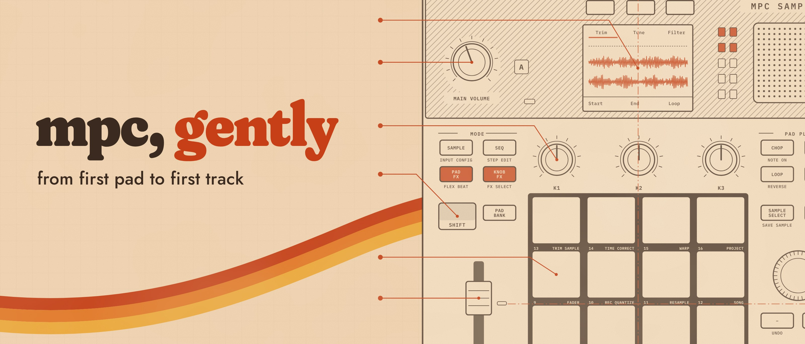
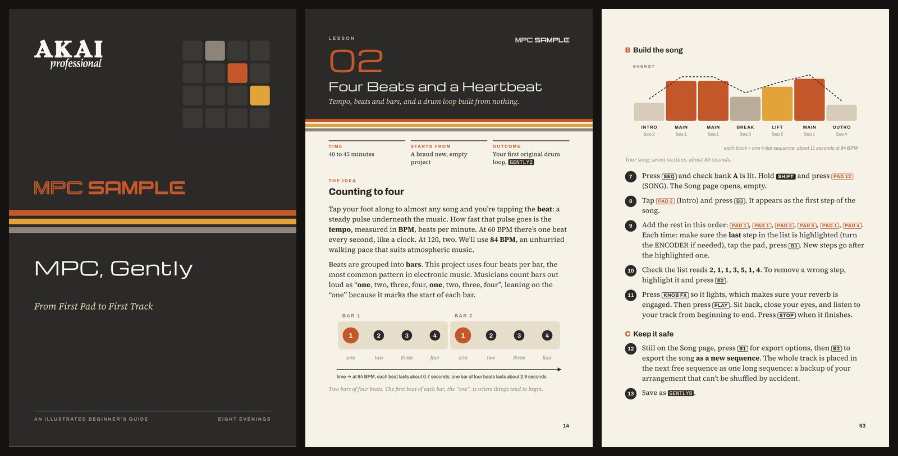
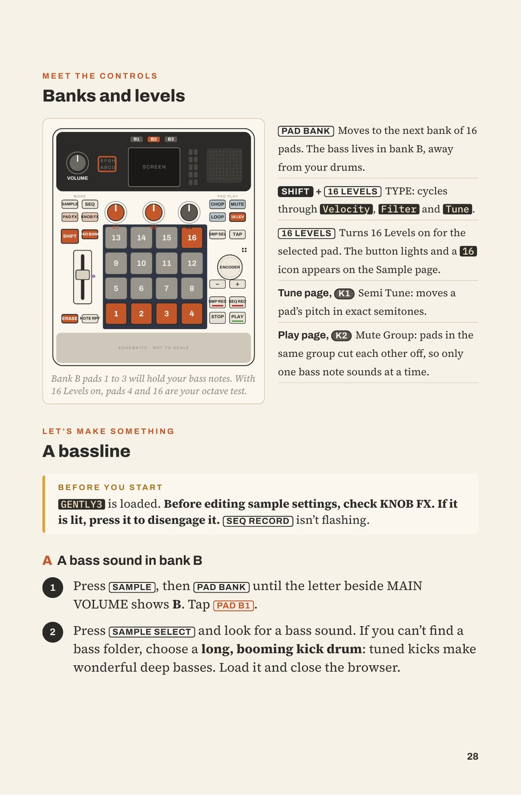
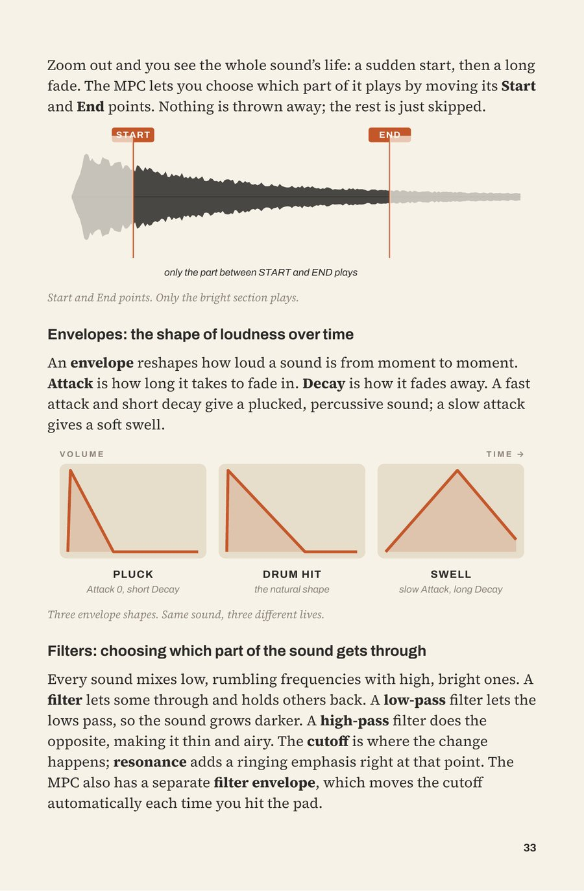

  

  
  

*A free, illustrated beginner's handbook for the [Akai MPC Sample](https://www.akaipro.com/mpc-sample).*

Not an equipment manual. Not a music-theory course. Just eight relaxed evenings with your MPC Sample, a pair of headphones and no computer, building one piece of slow, atmospheric electronic music from a single drum loop to a finished track.

No prior musical knowledge required.

---

## Download the handbook

| Edition | Best for | Size | Download |
| --- | --- | --- | --- |
| **iPad mini** (160 × 244 mm) | Portrait reading on the iPad mini, or any tablet or computer | 61 pages | [**Download the PDF**](https://github.com/slowphase/mpc-gently/releases/download/v0.9.0-preview/MPC-Gently.pdf) |
| **Editable source** | Revising the guide or adapting it, within the [licence](LICENSE.md) | ZIP archive | [**Download the source**](https://github.com/slowphase/mpc-gently/releases/download/v0.9.0-preview/MPC-Gently-source.zip) |

There is one edition, sized for comfortable reading on an iPad mini without zooming. The same source is also in the [`source/`](source/) folder.

**Handbook:** v0.9 Preview · **Firmware documented:** MPC Sample 1.3 · **Status:** pre-release, awaiting real-hardware testing

Future versions will appear on the [Releases page](https://github.com/slowphase/mpc-gently/releases).

> **A note on this preview.** Every instruction was checked carefully against Akai's official *MPC Sample User Guide* and the notes for firmware 1.3, but the lessons have not yet been worked through end to end on a physical MPC Sample. A few device behaviours still need hands-on confirmation (they are listed [below](#version-compatibility)). If something on your unit behaves differently from the book, please [tell us](#corrections-and-feedback) so the next version can fix it.

---

## A look inside

  

  
  &nbsp;
  

A warm, retro look for evening sessions · each lesson lights up only the controls it uses · pictures that explain the sound, not just the buttons.

---

## What you'll learn

Lesson 1 is a gentle tour of the instrument. Lessons 2 to 8 build one original track, one small idea at a time:

1. **Hello, MPC.** Play the demo, swap a sound, save your first project.
2. **Four Beats and a Heartbeat.** Tempo, beats and bars, and a drum loop recorded one drum at a time.
3. **Into the Atmosphere.** Lower, soften and layer a sound, and give it a room with reverb.
4. **The Low End.** Notes, semitones and octaves, and a simple bassline.
5. **Shape the Sound.** Waveforms, envelopes, filters and resampling: three new sounds from one.
6. **Everything Is an Instrument.** Record a mug with the built-in microphone, then trim and chop it.
7. **Give It Somewhere to Go.** Turn one loop into an intro, main section, breakdown, lift and outro.
8. **Your First Track.** Balance the mix and arrange it in Song Mode.

The finished piece is about 80 seconds long at 84 BPM. Every lesson takes 30 to 45 relaxed minutes, ends with a saved project, and uses only the MPC Sample, its built-in sounds and your headphones.

The book explains each musical idea the first time you meet it and favours practical exercises over feature lists. When you want more depth, it points you to Akai's own User Guide.

## Who it's for

- Complete beginners to samplers, sequencers and music theory.
- New MPC Sample owners who want to make music, not memorise menus.
- Anyone drawn to slow, atmospheric electronic music.
- People who would rather make a track on the sofa than at a computer.

---

## About the Akai MPC Sample

The **MPC Sample** is a compact, battery-powered sampler and sequencer from [Akai Professional](https://www.akaipro.com/), with 16 pads, a built-in microphone and speaker, and a headphone output. It works entirely on its own, with no computer required.

- [MPC Sample product page](https://www.akaipro.com/mpc-sample)
- [Official MPC Sample User Guide](https://www.akaipro.com/guides/mpc-sample/introduction.htm)
- [Firmware updates (official instructions)](https://www.akaipro.com/guides/mpc-sample/firmware_updates.htm)
- [Akai Professional support](https://support.akaipro.com/)

Please update your MPC Sample using Akai's official instructions, not this handbook.

*MPC, Gently* is an independent educational publication. It is not made, endorsed or supported by Akai Professional or inMusic.

---

## Version compatibility

The handbook has its own version number, separate from the firmware it describes. "v0.9 Preview" is the version of this book; "MPC Sample 1.3" is the firmware it was written for.

| | Status |
| --- | --- |
| Handbook | v0.9 Preview |
| Documented firmware | MPC Sample 1.3 |
| Reference documentation | Akai *MPC Sample User Guide* v1.0 |
| Hardware testing | Pending |
| Newer firmware | Consult Akai's [User Guide](https://www.akaipro.com/guides/mpc-sample/introduction.htm) and [firmware page](https://www.akaipro.com/guides/mpc-sample/firmware_updates.htm) |

Akai's guide doesn't settle every detail, so these behaviours still need confirming on a real MPC Sample:

- The names of the factory sample folders (only "Snares" is named in the guide).
- Whether Sequence Mode shares the pad-bank letter with Sample Mode.
- How far apart in pitch the 16 Levels (Tune) pads are.
- Whether a Knob FX keeps sounding while the KNOB FX button is dark.
- Whether RESAMPLE captures Knob FX.
- Which note lengths Note Repeat offers, and whether it follows pad pressure.

The lessons are written so that none of these can stop you finishing your track.

---

## Corrections and feedback

Spotted a wrong button combination, a menu that looks different, a sample that behaves unexpectedly, a diagram mistake or a step that didn't make sense? Please [open an issue](https://github.com/slowphase/mpc-gently/issues/new/choose). There are two short forms:

- **Technical correction:** something in the book does not match what the MPC Sample actually does.
- **Documentation or design improvement:** something could be clearer, kinder or easier to read.

No question is too small, and beginners' reports are especially welcome: you are exactly who the book is for.

---

## Credits and licences

- **Akai Professional** and **inMusic**, makers of the MPC Sample. The handbook was checked against the official *MPC Sample User Guide*. The Akai Professional and MPC Sample logos, and the labelled top-panel diagram reproduced from the User Guide, remain Akai's property.
- Typeset in **Michroma**, **Archivo**, **Source Serif 4** and **IBM Plex Mono** (SIL Open Font License 1.1).
- The handbook was developed with AI-assisted research, writing, coding, layout and review, and went through repeated rounds of review against the official documentation.

Full details, including what you may reuse and how: [CREDITS.md](CREDITS.md) and [LICENSE.md](LICENSE.md).

"Akai Professional", "MPC" and "MPC Sample" are trademarks of inMusic Brands, Inc. They are used here only to describe the hardware.
